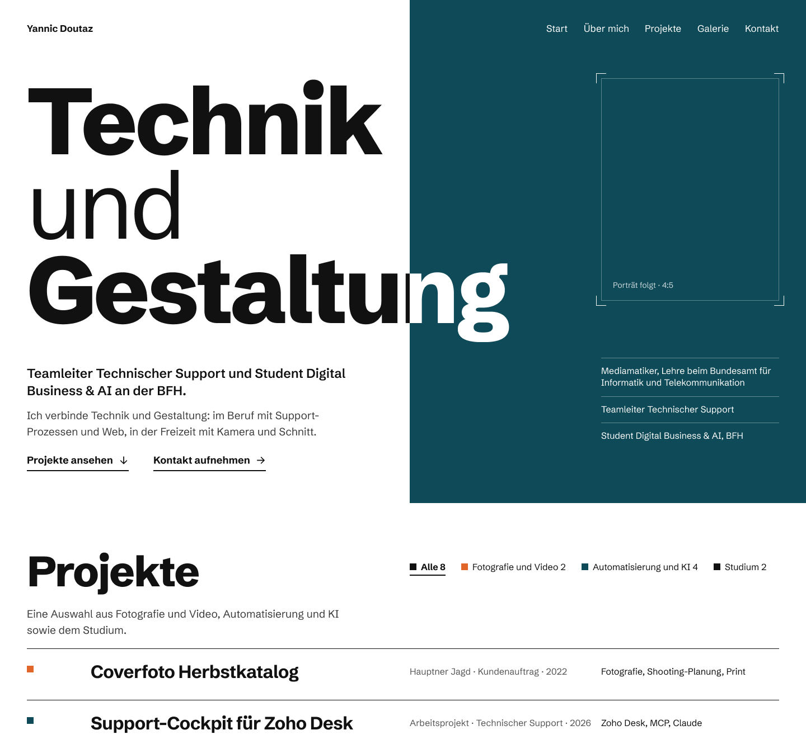

# 002 Visuelle Welt: Das Plakat

- Datum: 2026-11-09
- Status: entschieden
- Figma: [Portfolio Design, Seite «Runde 1 – Visuelle Welt»](https://www.figma.com/design/2t7VKj9aWQhTEDvceIYfvy?node-id=5-2)

## Ausgangslage

Die heutige Gestaltung ([`DESIGN.md`](../../../DESIGN.md), Stand 8.11.) ist nur eine
Referenz. Für das Redesign der Startseite galt:

- Im ersten Bildschirm führen Name und Aussage, Bilder kommen danach.
- Die Seite darf nicht werblich, technisch, verspielt oder beliebig wirken.
- Der dunkle Pin aus der Inspiration gibt nur die Stimmung vor (ruhig, hochwertig),
  nicht Farben oder Look.

## Varianten

- **A · Das Plakat:** Startseite als Schweizer Typo-Plakat. Das Wort «Gestaltung»
  läuft über die Kante vom weissen ins petrolfarbene Feld und wechselt dort die Farbe.
- **B · Der Kontaktbogen:** Projekte als Bilder auf Filmstreifen, das gewählte mit
  rotem Fettstift umkreist.
- **C · Die Vorlage:** das übliche Portfolio (Text links, Porträt rechts, Kartenraster),
  als Messlatte.

Sechs weitere Gegenvorschläge (u. a. Tauchgang, Sieben-Segment-Anzeige, Szene-Magazin)
wurden geprüft und verworfen. Je eine Regel daraus ist in A eingeflossen, siehe unten.

## Entscheid

Gewählt ist A. Die Kante, die das Wort schneidet, zeigt die Verbindung von Technik und
Gestaltung direkt im Satz, ohne Bild und ohne Erklärung. Die Variante bleibt ruhig und
sachlich und hebt sich trotzdem klar von der Vorlage C ab.

Regeln für die weitere Gestaltung:

- Eine Schrift (Schibsted Grotesk 400 und 800), Hierarchie nur über Grösse und Gewicht.
- Papierweiss, Tusche, Petrol als volle Fläche, Morgenorange nur für den Bereich
  Fotografie und Video.
- Jede Überschrift startet auf derselben linken Achse.
- Keine Karten und keine Schatten: Projekte als Zeilen mit Linien.
- Fehlende Bilder sind gestaltete Felder mit Passermarken.
- Rolle und Stationen stehen als kurze Randnotizen im Feld.

## Folgen für den Code

- Neue Tokens (Farben, Schrift, Raster) kommen aus den Figma-Variables. Sie ersetzen
  den heutigen `:root`-Block, sobald die Seite in Figma fertig gestaltet ist.
- Die Schrift Schibsted Grotesk wird aus dem Projekt geladen (eigene Font-Dateien,
  kein externer Dienst).
- Offen in Figma: mobile Fassung der Kante, Unterseiten, Galerie, Kontaktformular.
