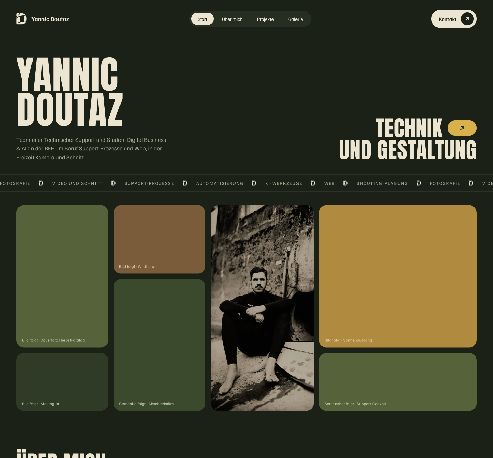

# 003 Visuelle Welt: Moos bei Nacht

- Datum: 2026-11-17
- Status: entschieden, löst [002 Das Plakat](002-visuelle-welt-plakat.md) ab
- Figma: [Portfolio Design, Seite «Runde 2 – Visuelle Welt»](https://www.figma.com/design/2t7VKj9aWQhTEDvceIYfvy?node-id=35-2)

## Ausgangslage

Variante A aus Runde 1 (Das Plakat) war gewählt und als ganze Startseite gestaltet. Beim
Ansehen der ganzen Seite wirkte sie zu eckig und zu kantig. Weil die Startseite das
Aussehen der ganzen Seite festlegt, kam eine zweite Runde dazu, mit diesen Vorgaben:

- Platzierung von Bildern, Formen und Elementen wie in zwei Vorlagen auf der Figma-Seite
  «Inspiration»: Bildmosaik, Laufband, Porträt mit Bögen, Bereiche, Projektkarten, grosser
  Name im Fuss.
- Farben ruhig und harmonisch: Grün, Gelb, Beige, Braun. Die Farben der Vorlagen werden
  nicht übernommen.
- Das Logo «D» (Flächenversion) und ein Porträt als Nassplatten-Aufnahme gehören dazu.

## Varianten

- **Stil 1 · Moos bei Nacht:** dunkler Grund in Moosgrün, Gold als einzige Signalfarbe,
  schmale Versalschrift passend zur Wortmarke.
- **Stil 2 · Kontaktabzug:** heller Grund wie Fotopapier, Beige, Braun und Olivgrün,
  Serifenschrift mit Kursiv.
- **Stil 3 · Sonnenaufgang:** volle Olivfläche mit gelber Sonne oben, Sand darunter,
  weiche, fette Serife.

## Entscheid

Gewählt ist Stil 1. Der dunkle Moosgrund lässt Porträt und Fotos leuchten, das Gold führt
den Blick zu den Aktionen, und die schmalen Versalien nehmen die Wortmarke auf.

Regeln für die weitere Gestaltung:

- Farben: Moos-Schwarz als Grund, eine hellere Moosfläche, Haferweiss für Text, Gold nur
  für Aktionen und Akzente. Olive, Rinde und Ocker nur als Bildfelder.
- Schrift: Anton in Versalien für Titel, Familjen Grotesk für Text.
- Formen: Pillen für Knöpfe und Navigation, runde Ecken an Bildern, goldene Viertelbögen
  am Porträt. Keine Schatten.
- Das D-Logo trennt die Begriffe im Laufband.
- Fehlende Bilder sind beschriftete Farbfelder, bis echte Fotos vorliegen.

## Folgen für den Code

- Die Tokens in `css/style.css` werden ersetzt (Farben, Schrift, Rundung, Abstände).
- Die Startseite wird im neuen Stil neu aufgebaut. Skills erscheinen als «Bereiche» mit
  Reitern, die Projekte behalten Filter und Karten aus `data/projekte.json`.
- Die Unterseiten übernehmen zunächst nur Farben und Schrift. Ihr eigener Aufbau folgt.
