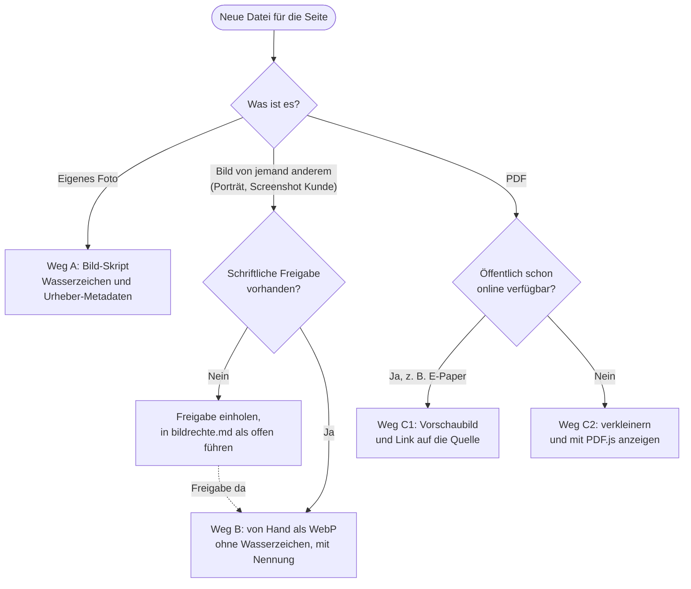
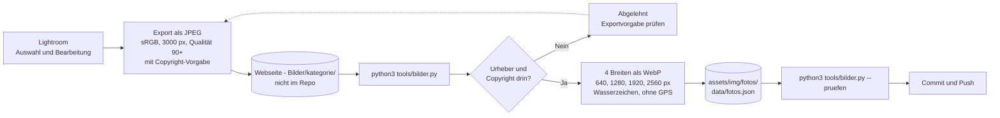
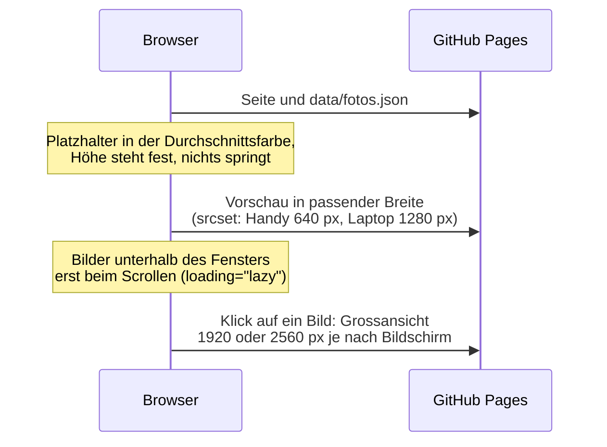
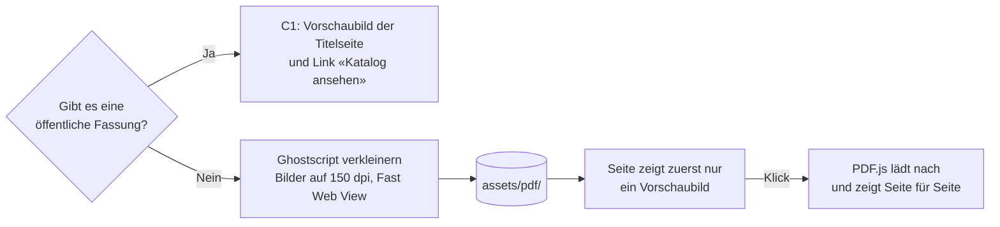

# Bilder und Dateien auf die Seite bringen

Wie Fotos, fremde Bilder und PDF-Dateien von der Ablage auf die Seite kommen. Ziel: scharfe
Bilder, kurze Ladezeit, klare Urheberschaft. Wer welches Bild gemacht hat und was davon noch
offen ist, steht in [bildrechte.md](../bildrechte.md).

## 1. Welcher Weg für welche Datei?

## 2. Weg A: eigene Fotos

### Export aus Lightroom

| Einstellung | Wert | Grund |
| --- | --- | --- |
| Format | JPEG, Qualität 90 oder höher | Ausgangsmaterial für das Skript, es verkleinert selbst |
| Farbraum | sRGB | Browser zeigen sRGB, andere Profile wirken flau |
| Grösse | lange Kante 3000 px | reicht für die grösste Stufe (2560 px) |
| Schärfen | Bildschirm, Standard | Schärfe nach dem Verkleinern |
| Metadaten | «Alle ausser Kamera- und Camera-Raw-Infos», Standortinfo entfernen | Urheber und Beschreibung bleiben, GPS fällt weg |
| Copyright-Vorgabe | Urheber «Yannic Doutaz», Copyright «© Jahr Yannic Doutaz», Status «urheberrechtlich geschützt» | das Skript lehnt Exporte ohne diese Angaben ab |
| Bildunterschrift | kurze Beschreibung des Bildinhalts | wird zum Alt-Text auf der Seite |
| Wasserzeichen | keines | setzt das Skript, so bleiben die Originale sauber |
| Dateiname | sprechend, z. B. `haslimoos-jaeger-nebel.jpg` | wird zum Namen der Web-Datei |

Der Unterordner bestimmt die Kategorie in der Galerie: `natur`, `auftraege`, `making-of`.

### Warum Wasserzeichen und Metadaten im Bild und nicht auf der Webseite

Ein Wasserzeichen aus CSS liegt nur über dem Bild. Wer das Bild speichert, bekommt es ohne.
Darum setzt das Skript das Zeichen fest in die Pixel. Die Metadaten entstehen beim Export, das
Skript prüft sie zweimal: beim Einlesen (Export ohne Angaben wird abgelehnt) und mit
`--pruefen` über alle Dateien in `assets/img/fotos/`, auch über solche, die jemand von Hand
dorthin kopiert hat.

## 3. Wie der Browser die Fotos lädt

Mit `srcset` und `sizes` wählt der Browser selbst die kleinste Datei, die auf seinem
Bildschirm noch scharf ist, auch auf Retina-Bildschirmen. Die grossen Stufen lädt nur, wer
ein Bild öffnet.

## 4. Weg B: Bilder von anderen

Gilt für das Porträt (Stefan Wermuth) und für Screenshots aus dem Katalog von Hauptner Jagd.

- Erst verwenden, wenn die Freigabe schriftlich vorliegt (Stand in [bildrechte.md](../bildrechte.md)).
- Kein Wasserzeichen mit meinem Namen und nicht in `assets/img/fotos/`, das Skript würde sie zu Recht ablehnen.
- Ablage in `assets/img/fremd/`, als WebP verkleinert, z. B. `cwebp -q 80 -resize 1600 0 eingang.png -o assets/img/fremd/name.webp`.
- Nennung direkt beim Bild (`<figcaption>`), mit Link, wenn die Person es wünscht.

## 5. Weg C: PDF-Dateien

- **C1, Hauptner-Katalog:** Der Katalog ist als E-Paper öffentlich
  ([yumpu.com](https://www.yumpu.com/de/document/read/67102472/j1-jagd-katalog)). Die Seite
  zeigt einen Screenshot der Titelseite (Weg B) und verlinkt das E-Paper. Kein eigener
  Upload, keine Einbettung: Die Einbettung von Yumpu bringt Werbung und Tracker mit.
- **C2, eigene PDFs:** verkleinern mit
  `gs -sDEVICE=pdfwrite -dPDFSETTINGS=/ebook -dFastWebView=true -o assets/pdf/name.pdf eingang.pdf`.
  «Fast Web View» ordnet die Datei so, dass PDF.js die erste Seite zeigen kann, bevor der
  Rest geladen ist. PDF.js wird erst beim Klick geladen, die Seite bleibt bis dahin leicht.
  Status: zurzeit nicht nötig, der einzige Katalog läuft über C1.
